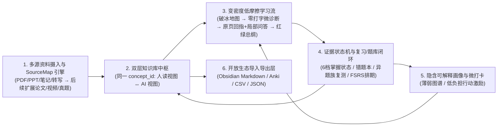

# 02. 个人复利型 AI 助教集成平台 — 完整功能蓝图与分期路线

> **文档边界**：本阶段**只讲清完整功能体系、模块协作关系、生态边界与分期落地节奏**，暂不进入具体 UI 视觉稿、数据库建表或代码实现细节。

---

## 一、产品核心定位与北极星目标

- **一句话定位**：**面向深度学习者的「证据驱动、个人复利型 AI 助教工作台」**——把被动的资料阅读，转化为低摩擦主动诊断、可溯源精修与跨周跨学科复利沉淀。
- **核心设计哲学（三条底线）**：
  1. **不靠聊天框启动，只在卡壳原页时按需问答**：主流程零打字降低启动摩擦，真卡死时才在原始材料旁原地唤起绑定该页的局部问答；
  2. **不把“看过/刷过”当掌握，只认独立可核查证据**：所有复习排期、笔记高亮与推荐动作都必须能回溯到“原页证据 + 历史作答证据”；
  3. **做个人复利中枢，不把用户锁死在封闭孤岛**：核心学习闭环集成在一个工作台内，同时原生开放 Markdown / Obsidian / Anki / JSON 双向互通，让用户的知识资产真正属于自己、越用越厚。

---

## 二、集成平台 6 大核心功能模块（完整全景）

整个平台由「**输入底座 → 双层知识中枢 → 变密度学习引擎 → 证据驱动复习与题库闭环 → 隐含画像与微打卡 → 开放生态接口**」六大模块组成，全部围绕统一的 **`concept_id`（知识点唯一标识）** 协同工作：

### 模块 1：多源资料摄入与页级 `SourceMap` 引擎（统一真相源）
- **做什么**：
  - 将学习资料拆解为带精确坐标的不可变原文锚点（PDF 页码与原页高清图、PPT 幻灯片号、文档段落与行号、未来扩展视频时间戳与论文图表编号）。
  - 自动检测解析置信度：文本型资料走极速抽取；遇到无文本层扫描件或复杂公式页，显式标出低置信度并保留原页图像作为视觉兜底，绝不拿识别错的乱码公式去出题。
  - **多源同源去重标注**：清晰区分“同一堂课的转写与笔记（同源加工层）”与“两本独立教材/论文（独立多源）”，不虚标交叉验证。
- **四类数据硬隔离**：原始材料（只读）、派生知识点/笔记、学生行为与作答证据、系统暂定推断四库严格分离，防止 AI 生成物或学生错题反向污染原始学科事实。

### 模块 2：个人复利知识库与双层知识索引（人读视图 ↔ AI 视图）
- **做什么**：
  - **人读视图（面向学生沉淀与查阅）**：结构化课程笔记、通俗类比、核心推导步骤、易错点清单、原文页码跳转、关联错题与个人批注；支持跨章节、跨课程按概念聚合检索，形成越积越厚的个人知识库。
  - **AI 视图（面向模型精准调度）**：与人读视图共享同一 `concept_id` 与版本号，但压缩为高密度机器上下文（概念定义边界、先修依赖、关联 `SourceMap` 片段 ID、历史作答/提示曝光记录、未关闭错因标签、下一步推荐教学动作）。
  - **候选变更审核机制（`ChangePlan`）**：AI 在学生答错或追问后提炼出的“新易错点/补充笔记”，先以候选补丁形式呈现，经学生一键确认后才合并入个人知识库，既保个人复利又防 AI 自动把知识库写乱。

### 模块 3：变密度低摩擦学习流（核心日常使用入口）
面向单章或单份资料的 4 步核心学习体验：
1. **低密度破冰地图（快速入场）**：先用大白话呈现本节知识骨架与逻辑主线，帮助 30 秒看懂“这章到底在解决什么问题”，并支持学生**一键勾选跳过已掌握板块**。
2. **零打字微诊断（主动戳破掌握幻觉）**：对未跳过板块逐块推送极轻量的概念诊断（辨误找茬、关键步填空、反直觉二选一/三选一 + 随时可点的**「我卡住了」**），不要求用户绞尽脑汁组织长提问；题目经防偏置校验（随机选项位置、均衡长度、反死记硬背）。
3. **回归原材料的精准溯源 + 按需局部 AI 问答**：
   - 答对：轻量确认核心逻辑，毫秒级滑向下一块；
   - 答错或点「我卡住了」：**原地展开原始材料精确页/原页图（可放大）+ 逐字原文证据高亮 + 错因一句话点破**；
   - **按需跳出锚定本页的局部 AI 问答**：仅在回归原页的卡片内提供「对这一页有疑问？」入口——先弹出 2–3 个针对本页公式/图表/概念的一键快捷追问胶囊，不够再自由追问；模型上下文严格锚定当前页与关联先修片段，**超出资料范围诚实拒答并标明属于课外延伸**。
4. **高密度个性化复习总纲（闭环收口）**：自动产出专业术语完整、带原页坐标的复习总纲，并依据刚才的真实作答自动分层（答错/卡壳块标红置顶展开，一次通过块标绿折叠），一键写入个人知识库或导出。

### 模块 4：反伪掌握证据状态机 + 题库 / 错题本 / 间隔复习闭环（复利核心）
- **严谨掌握状态机（6 档状态，防自欺欺人）**：
  - `UNKNOWN（未测）` → `NOT_YET（明显薄弱）` → `DEVELOPING（理解中）` → `PROVISIONAL（初步通过）` → `REVIEW_DUE（到期复测）` → `NEEDS_REVIEW（复习回退）`。
  - **晋级硬规则**：阅读笔记 ≠ 掌握；看提示或看答案后改对 ≠ 独立掌握；同题反复刷或仅换数字 ≠ 独立证据。必须在**不同题族（换表征或推理结构）、无提示且未看答案**下独立答对多次，才晋级为 `PROVISIONAL`。
- **三池题库与防烂题护栏**：
  - 严格拆分**诊断题池 / 练习题池 / 独立变式复测题池**，防止摸底泄题或学前错题永久锁死升级；
  - 题库采取**“AI 离线生成候选 + 结构化自动体检（证据匹配/答案均衡/歧义扫描）+ 人工或高置信核验入库”**，宁缺毋滥，单章严控核心题量（拒绝 AI 批量生成 50 张垃圾卡）。
- **错题本与科学间隔复习**：
  - 错题自动绑定 `concept_id`、原页坐标、当时所选错误项与错因标签，自动进入错题本；
  - 接入开源 FSRS 间隔重复思路，按遗忘曲线与距离考试天数（加最大间隔上限，防止排到考后）安排每日轻量回炉复测，真正产生跨周复利。

### 模块 5：隐含可解释用户画像 + 低负担微打卡
- **三层可解释用户画像**：
  - **显式偏好层**（目标考试/掌握深度、每日可用时长、讲解风格，随时可改）+ **原始行为证据层**（作答正误、提示曝光、停留与放大原页行为）+ **系统诊断推断层**（系统给每个薄弱点/前置缺口附带可读依据，允许学生质疑与覆盖）。
- **低负担微打卡与行动解耦**：
  - 打卡聚焦“降低今天打开学习的启动门槛”（如 5 分钟复测 3 个薄弱块），支持随时**缩小任务 / 暂缓 / 重新开始**，不做惩罚性焦虑设计；
  - **铁律**：行动打卡完成度与知识掌握状态严格分开计算，连续打卡 7 天不会让未掌握的概念伪装成“已掌握”。

### 模块 6：开放生态导入/导出与快慢路径底座
- **开放生态互通（不闭门造车）**：
  - 支持导入个人 Markdown / Obsidian 笔记作为课程补充源；
  - 支持将复习总纲、错题本、薄弱卡片一键导出为 **Obsidian 双链 Markdown / Anki 可导入卡包（CSV/APKG）/ 通用 JSON**，消除用户的“平台锁定顾虑”。
- **三条执行路径（保障体验丝滑与低成本）**：
  - **本地确定性路径（0 模型、毫秒级）**：地图渲染、跳过记录、客观题判分、状态机流转、错题入库、FSRS 排程、微打卡；
  - **日常快路径（有界检索 + ≤1 次快模型）**：回归原页后的局部问答与个性化提示，严格限制在当前页/本课范围内，缺证据即拒答；
  - **后台慢路径（异步离线）**：多源资料解析、双层知识索引构建、候选题库生成与质量体检。

---

## 三、明确边界：自研 vs 对接生态 vs 坚决不做

| 策略分类 | 具体模块 | 理由 |
| :--- | :--- | :--- |
| **核心自研（不可外包的核心差异）** | 变密度四步学习流、零打字微诊断、原页图回指 + 锚定局部问答、同一 `concept_id` 双层索引、反伪掌握 6 档状态机、证据化错题与复习总纲 | 这是与 NotebookLM / ChatGPT / 腾讯 ima 拉开代差的唯一主线。 |
| **轻量集成 / 导入导出对接（不重复造轮子）** | 间隔调度数学（复用开源 `py-fsrs`）、重型长文笔记编辑与双链白板（导出互通 Obsidian/Heptabase）、通用背诵卡库（导出对接 Anki）、文档基础解析（复用 `PyMuPDF` / 按需接入开源 OCR） | 避免 1–3 人团队把 80% 精力耗在造一个不如 Obsidian/Anki 的低配编辑器。 |
| **明确不做（防范围失控）** | 通用开放域 AI 聊天助手、社交广场/打卡攀比社区、复杂多租户商业 SaaS 权限、替代教师自动打分、未经核验的“任意扫描教材全自动零人工出题承诺” | 与“高信任个人复利助教”定位冲突，且直接引发 1–3 人团队维护雪崩。 |

---

## 四、分期演进路线（从窄闭环长成个人复利集成平台）

> **核心策略**：**架构按集成平台预留统一 `concept_id` 与数据隔离接口，落地按 V1 → V2 → V3 严格闯关演进**——每个阶段都必须先拿真实数据过门禁，才解锁下一阶段。

### 阶段 V1：高信任单章闭环（4–6 周 · 首发高校 AI 教育应用赛 & A/B 实证）
- **覆盖功能**：文本型 PDF/PPT 课件摄入与页级 `SourceMap` → 破冰地图（跳已知）→ 6–10 块高质微诊断（经自动体检 + 人工复核）→ 卡壳原地展原页图 + **锚定当前页的局部 AI 问答**（含快捷追问胶囊 + 越界拒答）→ 最小 `LearnerEvidence` 记录 → 红绿个性化复习总纲 + 一键导出 Obsidian Markdown / Anki CSV。
- **本阶段明确延后**：自建完整笔记编辑器、跨课程知识图谱、全自动无审核题库、视频/扫描件全覆盖、多账号体系、完整微打卡运营。
- **过关门禁**：通过《01_FEASIBILITY_RESEARCH_2026.md》定义的 3 条硬门禁（100 条证据抽检关键 0 错 + 15–20 人 A/B 后测增益 `≥ 1/8` + 20 人 7 日二次使用 `≥ 60%`）。

### 阶段 V2：单科跨章个人复利工作台（3–6 个月 · 承接大创 & 冲击挑战杯大挑科技发明 B）
- **升级功能**：
  - 正式上线**个人课程知识库（人读视图 ↔ AI 视图双层索引）**与 `ChangePlan` 候选笔记沉淀；
  - 打通**三池题库 + 异题族复测 + 6 档反伪掌握状态机 + 错题本**；
  - 集成开源 **`py-fsrs` 考期感知间隔复习**（设最大间隔上限防排到考后）与**低负担微打卡**；
  - 扩展多源输入至 **Markdown 笔记 + 课堂转写文本 + Word**，并跑通 30 天纵向对照实验。

### 阶段 V3：跨学科多源个人复利生态（6–12 个月 · 真实长期产品化）
- **升级功能**：
  - 扩展多源适配器至**学术论文精读、网课视频字幕时间戳定位、考研/专业真题集**，以及扫描件公式半自动校对流；
  - 打通跨课程先修概念关联与隐含可解释长期画像；
  - 强化 Obsidian / Anki 双向插件或同步桥接，让平台成为学生整个大学周期的个人知识复利中枢。

---

## 五、给独立评估者的开放质询点（欢迎重点挑刺）

1. **V1 边界够不够窄？** V1 已把“局部原页问答”放进来，是否仍有过度复杂或出题质量失控的风险？
2. **双层知识索引（人读 ↔ AI）的维护成本**：在 V2 跨章复利阶段，学生是否真的愿意点确认 `ChangePlan`，还是会成为新的维护负担？
3. **自动出题护城河**：若离开人工审核，仅靠多步 LLM 自检 + 证据回指校验，能否在多学科任意课件上把“高区分度好题率”做到 85% 以上？如果做不到，平台最现实的产品形态应该怎么调整？
4. **竞赛与产品张力**：V1 先打高校 AI 教育应用赛、V2 借大创攒纵向数据再冲挑战杯大挑，这条三赛节奏是否合理，还是应该直接放弃其中某一条线？
